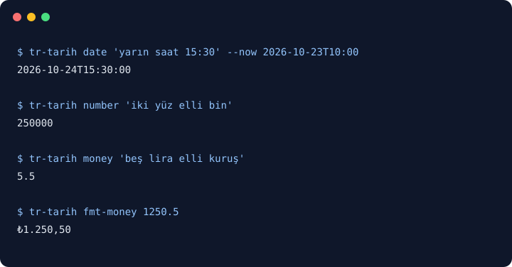

# tr-tarih
[](https://github.com/YusufBeratZengin/tr-tarih/actions/workflows/ci.yml) [](https://pypi.org/project/tr-tarih/) [](LICENSE)  
[English](README.md) | [Türkçe](README.tr.md)

Türkçe tarih, saat, sayı ve TL tutarlarını terminalden veya Python içinden ayrıştırın ve biçimlendirin.
Çalışırken ek bağımlılık ve internet gerektirmez; tip bilgisi sunar, belirsiz girdilerin neden anlaşılamadığını açıklar.
Bu kaynak kopyasından kurulum: `python -m pip install .`
Deneyin: `tr-tarih date "yarın saat 15:30" --now 2026-10-23T10:00`

```console
$ tr-tarih number "iki yüz elli bin"
250000
$ tr-tarih fmt-money 1250.5
₺1.250,50
```

## Demo



Görseli gerçek CLI çıktısından yeniden üretmek için `python scripts/make-demo.py` çalıştırın. Ekran yakalama servisi veya alt süreç gerekmez.

## Kurulum

Python 3.10 veya üzeri gerekir. Yukarıdaki komut bu kaynak kopyasını kurar; PyPI üzerinde yayımlanmış bir sürüm doğrulanmadı. Kurulum sırasında derleme bağımlılığı olarak Hatchling gerekir; kütüphane çalışırken üçüncü taraf paket kullanmaz.

Kurulum yapmadan kaynak yolunu tanımlayıp modülü çalıştırabilirsiniz:

```sh
# Linux / macOS
export PYTHONPATH=src
python -m tr_tarih --help
```

```powershell
# PowerShell
$env:PYTHONPATH = 'src'
python -m tr_tarih --help
```

Kurulumdan sonra `tr-tarih` ve `python -m tr_tarih` aynı argümanları kabul eder.

## Kullanım

### CLI

```sh
tr-tarih date "yarın saat 15:30" --now 2026-10-23T10:00
tr-tarih date "gelecek ayın son günü" --now 2026-10-23T10:00 --explain
tr-tarih number "bir virgül beş milyon" --json
tr-tarih money "beş lira elli kuruş" --json
tr-tarih words 1250
tr-tarih fmt-date 2026-10-23T15:30
tr-tarih fmt-money 1250.5 --style words
tr-tarih ago 2026-10-26 --now 2026-10-23
```

`date`, `number` ve `money`, `--json` ve `--explain` seçeneklerini destekler. JSON alanları `input`, `ok`, `value`, `reason`, `assumptions` şeklindedir; ondalık kesinliğini korumak için `value` metin ya da `null` olur. Çıkış kodları: **0** başarı/yardım, **1** anlaşılamayan ifade, **2** hatalı CLI kullanımı. JSON istenmediyse hatalar stderr'e yazılır. Negatif konumsal sayılarda `tr-tarih words -- -5` kullanın.

### Python API

```python
from datetime import datetime
from tr_tarih import DateParser, format_money, parse_datetime, parse_money, parse_number

reference = datetime(2026, 10, 23, 10)
assert parse_datetime("yarın saat 15:30", reference).isoformat() == "2026-10-24T15:30:00"
assert parse_datetime("yarın saat 15:30", reference, tz="+03:00").isoformat() == "2026-10-24T15:30:00+03:00"
assert parse_number("iki yüz elli bin") == 250000
assert format_money(parse_money("beş lira elli kuruş")) == "₺5,50"

parser = DateParser(reference=reference, tz="UTC")
assert parser.parse_datetime("yarın saat 15:30").isoformat() == "2026-10-24T15:30:00+00:00"
```

`parse_date`, `parse_datetime`, `parse_number` ve `parse_money`, belirsiz girdide `ValueError` alt sınıfı olan `ParseError` fırlatır. `*_detailed` sürümleri ise değiştirilemeyen bir `ParseResult` döndürür: `.ok`, `.value`, `.reason`, `.assumptions` ve `.unwrap()` kullanılabilir.

Tarihler `date` / `datetime`; tam sayılar `int`, kesirli sayılar `Decimal`; tutarlar her zaman `Decimal` döner. `format_date`, `format_datetime`, `format_relative`, `format_number`, `number_to_words` ve `format_money` Türkçe çıktı üretir. Tarih ve tutar biçimi tipleri `tr_tarih.dates` ve `tr_tarih.money` modüllerinde bulunur.

## Örnekler

Proje kökünden `python examples/basic.py` çalıştırın; kurulum zorunlu değildir. Gerçek çıktısı:

```text
2026-10-24T15:30:00
250000
₺5,50
bin iki yüz elli
```

Diğer bağımsız örnekler:
- `python examples/dates_and_times.py`: Doğal takvim ifadeleri, gün bölümleri, göreli zaman farkları ve biçimlendirme.
- `python examples/money_and_numbers.py`: Yazıyla sayılar, TL ayrıştırma, biçimlendirme stilleri ve hata yönetimi.

## Yapılandırma / seçenekler

Ayar dosyası, locale kurulumu veya ağ bağlantısı gerekmez.

| Komut / API | Seçenekler | Varsayılan |
| --- | --- | --- |
| `date` | `--now` / `--reference`, `--tz` / `--timezone`, `--strict`, `--json`, `--explain` | Yerel mevcut zaman |
| `DateParser` | `reference`, `tz` / `timezone`, `strict` | Yerel mevcut zaman, saat dilimsiz |
| `number`, `money` | `--json`, `--explain` | Düz metin |
| `words` | Ondalık nokta veya virgül içeren sayı | Türkçe sayı sözleri |
| `fmt-date` | `--style long/short/iso`, `--no-weekday` | Uzun biçim, gün adı dahil |
| `fmt-money` | `--style symbol/suffix/words` | `₺1.250,50` |
| `ago` | ISO referansı `--now`, `--tz` | Değerin saat dilimindeki mevcut zaman |
| `format_date` | `weekday`, `style` (`long`/`short`/`iso`) | `True`, `long` |
| `format_datetime` | `weekday`, `seconds` | `True`, `False` |
| `format_number` | `decimals` (negatif olmayan tam sayı) | Kesir basamakları korunur |
| `format_money` | `style`, `cents` | `symbol`, `True` |

## Nasıl çalışır?

Türkçeye uygun harf dönüşümü; noktalı/noktasız I, ASCII yazımlar ve yaygın ekleri işler. Kurallı ayrıştırıcı sayıları, takvim ifadelerini, hafta günlerini, süreleri ve saat dilimlerini (`TSİ`, `TRT`, `UTC`, `GMT`, `Z`, `+03:00`) okur. İşlenemeyen sözcükler, çelişkili zaman bölümleri, belirsiz Türkçe ifadeler (`hafta sonu`, `hafta içi`, `akşamüstü`, `sabaha karşı`, `birkaç gün sonra`, gün adı belirtilmeyen `gelecek hafta`) veya çelişen tarihler varsa tahmin yürütmek yerine açıklamalı bir gerekçe döner.

Ay/yıl eklerken gün, hedef ayın son gününü aşmaz: 31 Ocak'tan bir ay sonrası 28 veya 29 Şubat'tır. Saat verilmeyen tarih gece yarısına ayarlanır; süre ekleme işlemi referans saati korur. Tek başına gün adı bugün veya sonraki ilk eşleşmedir. `gelecek cuma` kesinlikle gelecekteki cuma, `bu cuma` ise pazartesi başlayan mevcut haftanın cumasıdır. Eksik yılda referans yılı kullanılır. İki basamaklı yıllar 2000–2099 aralığına karşılık gelir.

12'den küçük yalın saatlerde gün bölümü (`akşam yedi`) veya açık saat biçimi (`07:00`) gerekir. Saat belirtilmezse sabah 08:00, öğle 12:00, öğleden önce 10:00, öğleden sonra 15:00, ikindi 16:00, akşam 19:00, gece 22:00, gece yarısı 00:00 kullanılır. Ayrıntılı sonuçlar eksik yıl, yalın hafta günü, gün bölümü saati ve eksik para birimi varsayımlarını gösterir; `strict=True` veya CLI `--strict` ile örtük varsayımlar reddedilebilir.

## Sınırlar / gizlilik

- Belirli ifadeleri ayrıştırır; genel Türkçe dil modeli veya serbest metinden bilgi çıkarıcı değildir. Yazıyla takvim günü, tatiller ve tekrar kuralları desteklenmez.
- Tekrarlanabilir sonuç için `reference` / `now` / `--now` ve `tz` / `--tz` verin. Kütüphane referansın saat dilimini korur; ISO saat farkları, IANA adları (örneğin `Europe/Istanbul`) ve Türkçe saat dilimi kısaltmaları (`TSİ`) desteklenir. `ago` için iki zamanın da saat dilimi içermesi veya ikisinin de saat dilimsiz olması gerekir.
- Ayraçlar Türkçe kurallara uyar: `1.250` sayısı 1250, `1,250` sayısı 1,25 demektir. `1,250.50` gibi İngilizce karma gruplama da kabul edilir. Sayıyı yazıya çevirme `10**18` altındaki büyüklükleri destekler.
- Yalnızca Türk lirası desteklenir; birim verilmezse TL varsayılır. Biçimlendirme yarımı yukarı yuvarlayarak kuruşa indirir; ayrıştırma girişin hassasiyetini korur. Tutar biçimlendirmesine float ve bool vermeyin; `Decimal`, tam sayı veya ondalık noktalı metin kullanın.
- Göreli gösterim tam birimler kullanır; ay 30, yıl 365 gündür. On saniyeden küçük fark `şimdi` olarak gösterilir. Takvim ayrıştırmada yıl aralığı 1–9999'dur.
- Girdiler süreç içinde kalır. Telemetri, ağ isteği, kalıcı geçmiş veya dış servis yoktur. JSON çıktısı verilen ifadeyi de içerir; çıktıyı buna göre yönetin.

## Geliştirme

Kaynak kopyasının kökünde:

```sh
python -m pip install -e ".[dev]"
python -m ruff check .
python -m mypy src
python -m pytest -q
python scripts/make-demo.py
python -m build
python -m twine check dist/*
```

Testler internetsiz çalışır; sabit referanslar ve süreç içi CLI girişleri kullanır. Pytest, **satır ve dal kapsamı birlikte en az %85** eşiğini uygular. CI, Ubuntu ve Windows'ta Python 3.10–3.14 ile çalışır; dağıtım meta verisini ve kurulumu ayrıca denetler. Örnek ve demo üreticisi çalışma zamanı bağımlılığı gerektirmez.

## Katkı

[CONTRIBUTING.md](CONTRIBUTING.md), [davranış kuralları](CODE_OF_CONDUCT.md), [SECURITY.md](SECURITY.md) ve [CHANGELOG.md](CHANGELOG.md) dosyalarına bakın. Etiket üzerinden yayın iş akışı hazırdır; yayın için bakımcının PyPI trusted publisher ayarını yapması gerekir.

## Lisans

[MIT](LICENSE), telif hakkı 2026 Yusuf Berat Zengin.
